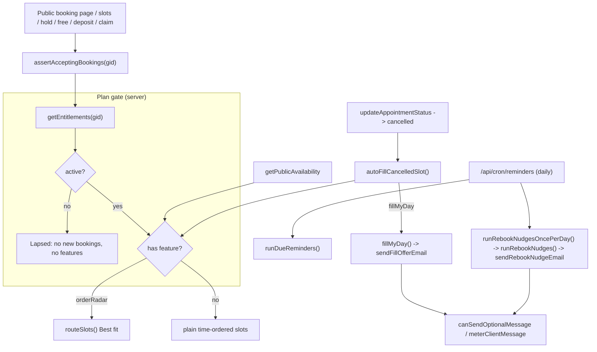

# Design Document

## Overview

This design makes every Solo and Pro claim true and enforced. It reuses the existing pieces and adds no new dependencies:

- `getEntitlements(groomerId)` and `hasFeature` (`src/lib/billing/entitlements.ts`, `src/lib/plans.ts`) remain the single source of plan truth.
- The email layer (`src/lib/email/send.ts`, `layout.ts`) gains two client emails: a Fill My Day offer and a rebooking nudge.
- Message metering (`src/lib/messaging/usage.ts`) counts the new emails as optional messages.
- The coat interval math (`src/lib/rebooking/interval.ts`) becomes the only next-visit rule.
- The existing daily Vercel cron (`/api/cron/reminders`) also runs the rebooking sweep.

Requirement 5.4 (set `lastGroomAt` and `nextDueAt` on completion using the coat interval) is already implemented in `updateAppointmentStatus` (`src/actions/appointments.ts`). The design keeps it and only adds a test.

## Architecture



## Components and Interfaces

### 1. Booking guard (Requirement 2)

New module `src/lib/billing/booking-guard.ts`:

```ts
export class BookingsPausedError extends AppError {} // code 'BOOKINGS_PAUSED', status 403

/** PURE: whether an entitlement view may take new bookings. */
export function acceptsBookings(ent: Pick<Entitlements, 'active'>): boolean;

/** Resolve entitlements and throw BookingsPausedError for a Lapsed_Account. */
export async function assertAcceptingBookings(groomerId: string): Promise<void>;
```

It reuses the 60-second Entitlements cache, so reactivation takes effect within 60 seconds (2.4). The Polar webhook already calls `invalidateEntitlements`, which makes it immediate in practice.

Call sites (each converts the error into its existing error envelope, with the message "This business isn't taking online bookings right now."):

| Entry point | File |
|---|---|
| Booking page render | `src/app/(booking-standalone)/book/[groomerSlug]/page.tsx`: when `acceptsBookings` is false, render a `BookingsPaused` notice (business name, phone, email) instead of the wizard. |
| Slot list | `src/actions/availability-public.ts` `getPublicAvailability` |
| Slot hold | `src/app/api/booking/hold/route.ts` (returns 403 `{ error: 'bookings_paused' }`) |
| Free / payment-link booking | `src/actions/booking-free.ts` |
| Own-Stripe deposit checkout | `src/lib/stripe/own-checkout.ts` `startOwnStripeCheckout` |
| Connect deposit intent | `src/lib/stripe/helpers.ts` `createDepositPaymentIntent` |
| Fill My Day claim | `src/lib/fill/claim.ts` `confirmClaim` |

The rebook page (`/rebook/[token]`) uses the same slot, hold, free and deposit entry points, so it is covered. Paid-return confirmation (`/book/[slug]/paid`, the Stripe webhooks) is NOT guarded: a client who already paid must always get the booking. Existing appointments, pet cards, receipts and the ICS feed read data without the guard (2.3).

### 2. Pro gating of route ranking and radar data (Requirement 1)

- `getPublicAvailability`: after resolving the profile, call `getEntitlements(profile.userId)`. Run `routeSlots()` only when `checkFeature(ent, 'orderRadar') === null`. Otherwise return `routed: false`, `outsideArea: false` and slots without `label` / `extraDriveMin`.
- `annotateRoute()` in `fulfil.ts` and `createManualAppointment` keep storing `routeMeta` for every plan. The data is harmless, and a groomer who upgrades sees routes for bookings made while on Solo.
- `dashboard/page.tsx`: when `radarLocked` is true, pass `radar: []` and strip `travelToNext` from `stops`. The radar card already renders its locked state from `radarLocked`.
- `smartSlots` is the feature key that describes this behaviour, but `orderRadar` is the key the pricing copy names. Both are Pro-only, so the gate uses `orderRadar` and `smartSlots` stays an alias with no separate call site.

### 3. Fill My Day by email, started on cancel (Requirement 3)

**Email.** New `sendFillOfferEmail(to, d: FillOfferDetails)` in `send.ts`:

```ts
interface FillOfferDetails {
  businessName: string; petName?: string; date: string; time: string;
  claimUrl: string; replyTo?: string; groomerPhone?: string;
}
```

It contains a heading ("A spot just opened up"), detail rows (date, time), a primary `button(claimUrl, 'Claim this time')`, a note that the first client to claim gets the slot, and the existing footer. Subject: `"{Business} has an opening on {date} at {time}"`. It gets an `email-preview` entry named `fill-offer`.

**Delivery.** `offerToCandidate` in `src/lib/fill/fill.ts` changes:

1. Load the client's `email` (candidates now carry `email`; `gatherCandidates` selects it in both the waitlist populate and the due-pet lookup).
2. Skip the candidate when there is no email (3.4) or `canSendOptionalMessage(groomerId)` is false (3.2). A skipped candidate does not count toward `offered`.
3. Store the claim token as today.
4. Send `sendFillOfferEmail` with Reply-To `profile.businessEmail || user.email` and the date and time formatted in `profile.timezone`. On success, call `meterClientMessage(groomerId)`.
5. Keep the `sendSms` call behind `isTwilioConfigured()` for later SMS support; it stays a no-op today.

The ranker in `src/lib/fill/candidates.ts` drops `smsOptOut` clients. An email offer should not depend on SMS opt-out, so the email path passes `smsOptOut: false`.

**Automatic start.** New `autoFillCancelledSlot(groomerId, appointment)` in `src/lib/fill/auto.ts`:

```ts
export function shouldAutoFill(slotStartMs: number, nowMs: number): boolean; // PURE: start - now > 2h
export async function autoFillCancelledSlot(groomerId: string, appt: { scheduledDate: Date; scheduledEndDate: Date }): Promise<void>;
```

It returns early unless `shouldAutoFill` holds and `checkFeature(await getEntitlements(gid), 'fillMyDay') === null`. Then it calls `fillMyDay(gid, start, end)`. `updateAppointmentStatus` calls it in the existing best-effort `newStatus === 'cancelled'` block, after cancelling reminders. The call is awaited inside `try/catch` so that a failure never fails the status change. On serverless the request must not return before the work is done, which is why it is awaited instead of fired and forgotten.

**Recording (3.5).** `fillMyDay` already creates a `FillEvent` per run, and the claim flow sets `filledBy` and `revenueRecovered`. The dashboard query already sums those, so auto runs are included with no change.

### 4. Rebooking autopilot by email on the daily cron (Requirement 4)

**Email.** New `sendRebookNudgeEmail(to, d: RebookNudgeDetails)`:

```ts
interface RebookNudgeDetails {
  businessName: string; petName: string; dueDate: string;
  bookUrl: string; replyTo?: string; groomerPhone?: string;
}
```

Heading "Time for {pet}'s next groom", a body line naming the due date, `button(bookUrl, 'Book {pet}\u2019s visit')`, and the footer. Subject: `"{Pet} is due for a groom"`. Preview name: `rebook-nudge`.

**Sweep changes** in `src/lib/rebooking/nudges.ts`:

- Select the client's `email` instead of requiring `phone` and `smsConsentAt`. Skip when there is no email.
- Replace `shouldNudge(lastNudgedAt, now)` with a once-per-cycle rule:

  ```ts
  /** PURE: nudge once per due cycle. */
  export function shouldNudge(lastNudgedAt: Date | null | undefined, nextDueAt: Date, now?: Date): boolean;
  // true when lastNudgedAt is missing, or lastNudgedAt < nextDueAt - 7 days
  // (i.e. the last nudge belonged to an earlier cycle).
  ```

  Completing an appointment moves `nextDueAt` forward by the coat interval, which opens a new cycle.
- Before sending, check `canSendOptionalMessage(groomerId)`. On a successful send, call `meterClientMessage(groomerId)` and set `lastNudgedAt = now`.
- The Pro gate per groomer (`assertFeature(gid, 'rebookAutopilot')`) is unchanged.

**Scheduling.** `src/app/api/cron/reminders/route.ts` calls `runRebookNudgesOncePerDay()` after `runDueReminders()` and returns both results. That function lives in `src/lib/rebooking/daily.ts`:

```ts
export async function runRebookNudgesOncePerDay(now = new Date()): Promise<RebookNudgeResult | { skipped: 'already_ran_today' }>;
```

It takes a Redis key `cron:rebook:{YYYY-MM-DD}` with `SET NX EX 90000`. A later call on the same UTC day (from the 15-minute external cron, if the founder sets it up) skips the sweep. Without Redis the sweep runs anyway, and the once-per-cycle rule still prevents duplicate nudges. The QStash route `/api/qstash/rebook-nudges` stays for compatibility.

### 5. Coat-based next visit (Requirement 5)

`src/lib/pet-card/assemble.ts`:

```ts
export function computeNextRecommendedDate(input: {
  nextDueAt?: Date | null;
  lastServiceDate: Date | null;
  coat?: string | null;
  rebookIntervalWeeks?: number | null;
  fallbackIntervalDays?: number | null;
}): Date | null;
```

Rules in order:
1. `nextDueAt` is set → return it (5.1).
2. `lastServiceDate` is null → return null (5.3).
3. The coat maps to `COAT_INTERVAL_WEEKS`, or `rebookIntervalWeeks > 0` → `computeNextDueAt(lastServiceDate, coat, override)` (5.2).
4. Otherwise → `lastServiceDate + fallbackIntervalDays` when it is a positive number, else `computeNextDueAt` with the 6-week fallback (5.5).

`AssemblePetCardInput.intervalDays` is replaced with `pet.nextDueAt`, `pet.coatCondition`, `pet.rebookIntervalWeeks` and `fallbackIntervalDays`. Both callers (`src/actions/pets.ts` and `src/app/(public)/pet-card/[cardId]/page.tsx`) select those pet fields and pass `profile.serviceIntervalDays` as the fallback. The shared card image renders from the assembled card, so it follows automatically.

`interval.ts` gains `export function isKnownCoat(coat): boolean` so that rule 3 can tell a mapped coat from the fallback.

### 6. Plan copy (Requirement 6)

A new `src/content/plan-features.ts` holds the single feature list per plan:

```ts
export const PLAN_FEATURES = {
  solo: ['Branded booking page', 'Deposits & no-show protection', 'Native calendar & ICS feed',
         'Client messaging by email (800/mo)', 'Digital Pet Cards', 'Appointment reminders'],
  pro:  ['Everything in Solo', 'Order Radar route ranking', 'Fill My Day auto-offers',
         'Live \u201con the way\u201d tracking', 'Rebooking autopilot', 'Before/after share cards',
         'Client messaging by email (2,000/mo)'],
} as const;
```

The message counts come from `PLANS.solo.sms` and `PLANS.pro.sms`, so the copy cannot drift from the allowance.

Consumers:
- `landing.ts` `pricing.plans[].features` and `for-groomers.ts` plan features read `PLAN_FEATURES`.
- `BillingView.tsx` plan cards render the same list as a short bullet list, replacing the one-line summaries and "& more".
- The `landing.ts` bento card "Two-way texting" becomes "Client messaging": "Confirmations, reminders and messages by email, sent in your name. Replies come straight to your inbox."
- The bento card "Smart booking page" keeps its copy and gets a "Pro" tag for the route-fit wording.
- Comparison rows gain an optional `proOnly?: boolean`. `Comparison.tsx` renders a small "Pro" pill next to the label. Rows: route-aware booking (proOnly), extra driving per booking (proOnly), auto-fills cancelled slots (proOnly), "Client messaging included" (true / "Extra add-on"), Digital Pet Cards, built for a solo van, starting price.
- `jsonld.ts` description: replace "two-way texting" with "client messaging".
- `reviewRequests`, `customTemplates` and `optimizeDay` stay in `FEATURE_KEYS` and are not mentioned in any copy (6.4).

## Data Models

There are no schema changes. The design uses existing fields:
- `Pet`: `coatCondition`, `rebookIntervalWeeks`, `lastGroomAt`, `nextDueAt`, `lastNudgedAt`.
- `Client`: `email` (required on the model).
- `GroomerProfile`: `serviceIntervalDays` (fallback only), `businessEmail`, `phone`, `timezone`.
- `FillEvent`: unchanged.
- Redis: new key `cron:rebook:{YYYY-MM-DD}` (TTL 25 h).

## Correctness Properties

*A property is a characteristic or behavior that should hold true across all valid executions of a system: a formal statement about what the system should do. Properties serve as the bridge between human-readable specifications and machine-verifiable correctness guarantees.*

### Property 1: Plan gate matrix

*For any* advertised Pro_Feature `f` and any subscription input, `checkFeature(resolveEntitlements(sub), f)` is null exactly when the resolved view is active and its plan is `pro` or `trial`. For an active Solo subscription it is always a `FEATURE_LOCKED` error.

**Validates: Requirements 1.4, 1.5**

### Property 2: Lapsed accounts never accept bookings

*For any* subscription input, `acceptsBookings(resolveEntitlements(sub, now))` equals `resolveEntitlements(sub, now).active`. In particular it is false for every expired trial, canceled or expired row, past_due row after grace, and active row whose `currentPeriodEnd` is 7 or more days in the past.

**Validates: Requirements 2.1, 2.2, 2.4**

### Property 3: Route ranking only for orderRadar

*For any* entitlement view without `orderRadar` and any slot list, the slots returned by the availability shaping step equal the input slots in time order with no `label` and no `extraDriveMin`, and `routed` is false.

**Validates: Requirements 1.1, 1.2**

### Property 4: Auto-fill timing

*For any* `slotStartMs` and `nowMs`, `shouldAutoFill(slotStartMs, nowMs)` is true exactly when `slotStartMs - nowMs > 2 hours`.

**Validates: Requirements 3.3**

### Property 5: One nudge per due cycle

*For any* `nextDueAt`, `now` and a sequence of sweep runs in which every successful run sets `lastNudgedAt = now`, at most one nudge is sent while `nextDueAt` is unchanged.

**Validates: Requirements 4.3**

### Property 6: Next visit follows the pet

*For any* inputs: when `nextDueAt` is set the result equals it; when it is unset and `lastServiceDate` is null the result is null; when it is unset, `lastServiceDate` is set and the coat is known, the result equals `lastServiceDate + resolveIntervalWeeks(coat, override)` weeks, independent of `fallbackIntervalDays`.

**Validates: Requirements 5.1, 5.2, 5.3, 5.5**

### Property 7: Optional messages respect the allowance

*For any* `used`, `included` and `topup` with `used >= included + topup`, `canSendOptionalMessage` is false, and neither the Fill offer nor the rebook nudge path calls the email sender.

**Validates: Requirements 3.2, 4.4**

## Error Handling

- **Guard failures.** `assertAcceptingBookings` throws `BookingsPausedError`. Each call site maps it to its existing error envelope or HTTP 403. If entitlements cannot be loaded, `getEntitlements` falls back to the trial view, so an outage never blocks bookings (existing behaviour).
- **Auto-fill and nudges** are best-effort: wrapped in `try/catch`, logged with the `[fill]` / `[rebook]` prefixes, never thrown to the caller. A cancellation always succeeds even when Fill My Day fails.
- **Email delivery failure.** `deliver()` returns false. The candidate or pet is not metered and `lastNudgedAt` is not set, so the next run retries.
- **Missing Redis.** Claim and rebook tokens need Redis. Without it the candidate is skipped and logged, as today. The daily-run key is skipped, and the once-per-cycle rule still holds.

## Testing Strategy

Vitest plus `fast-check` (already a dev dependency). Each property test runs at least 100 iterations and is tagged `Feature: plan-claims-audit, Property N: <title>`.

- **Property tests** (pure functions): `checkFeature` and `resolveEntitlements` (P1), `acceptsBookings` (P2), the extracted pure slot-shaping helper `shapeSlotsForPlan` in `availability-public.ts` (P3), `shouldAutoFill` (P4), `shouldNudge` (P5), `computeNextRecommendedDate` (P6), and the allowance predicate extracted from `canSendOptionalMessage` as `hasAllowance(used, included, topup)` (P7).
- **Example tests:**
  - `sendFillOfferEmail` and `sendRebookNudgeEmail` via `captureEmails`: From, Reply-To, subject, claim/book link and the plain-text part.
  - Copy consistency: `landing.ts`, `for-groomers.ts` and `BillingView` read `PLAN_FEATURES`, and no copy file contains "two-way texting", "SMS" or "texting".
  - Completion sets `nextDueAt` from the coat (5.4), using the existing pure `computeNextDueAt`.
- **Regression:** the full `npx vitest run` passes except the two pre-existing `tests/calendar-holds.test.ts` failures. Then `npx tsc --noEmit`, `npm run lint` and `npm run build`.