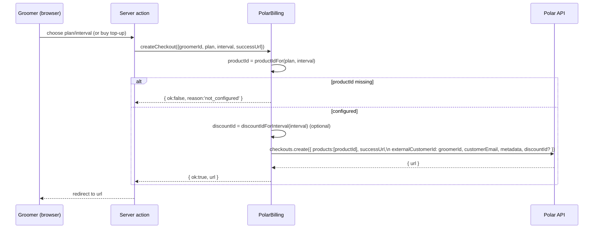
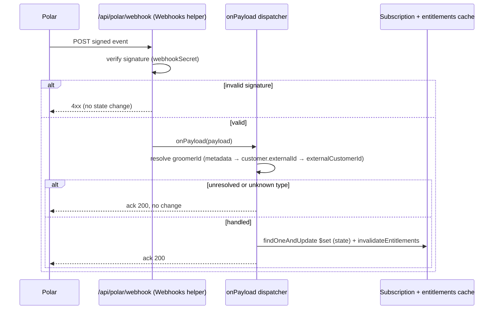

# Design Document

## Overview

This feature adds **Polar** (polar.sh, a merchant-of-record) as the billing provider for Pawxis's **own revenue** — groomer subscriptions (Solo/Pro × month/year) and one-time SMS top-ups. The platform founder is based in Pakistan and cannot receive money through Stripe, so this money flow (groomer → platform) moves to Polar.

The **client → groomer deposit** flow stays on **Stripe Connect**, unchanged, because Polar is a merchant-of-record and cannot perform marketplace split-payouts to third-party connected accounts.

The design reuses every existing seam rather than rebuilding:

- The provider-agnostic `BillingProvider` interface (`src/lib/billing/provider.ts`) and its `BillingResult` envelope.
- The entitlements state machine (`src/lib/billing/entitlements.ts`) and the `Subscription` model.
- The plan catalog (`src/lib/plans.ts`).

New pieces plug in behind these seams:

1. A lazy Polar client singleton `getPolar()` mirroring `getStripe()`.
2. A `PolarBilling` class implementing the full `BillingProvider` interface. It handles `createCheckout` / `createPortal` / `createSmsTopupCheckout` on Polar, delegates `createConnectAccountLink` to `StripeBilling`, and keeps `startTrial` local (same local upsert as `StripeBilling.startTrial`).
3. A pure product-mapping module mapping `(plan, interval)` ↔ Polar product id and resolving the discount id by interval.
4. A new webhook route `src/app/api/polar/webhook/route.ts` using the `@polar-sh/nextjs` `Webhooks()` helper.
5. Additive `polarCustomerId` / `polarSubscriptionId` fields on the `Subscription` model (no migration).
6. An `isPolarConfigured()` check and an updated `getBillingProvider()` selection precedence.

### Verified Polar SDK facts (pinned)

Confirmed against the official `@polar-sh/sdk` model docs ([CheckoutCreate](https://github.com/polarsource/polar-js/blob/main/docs/models/components/checkoutcreate.md), [CustomerSession](https://github.com/polarsource/polar-js/blob/main/docs/models/components/customersession.md), [Next.js adapter](https://polar.sh/docs/integrate/sdk/adapters/nextjs)). Content was rephrased for compliance with licensing restrictions.

- **Client**: `import { Polar } from '@polar-sh/sdk'; new Polar({ accessToken, server })` where `server` is `'sandbox' | 'production'`.
- **Checkout**: `polar.checkouts.create({ products: string[] /* required */, successUrl, externalCustomerId, customerEmail, metadata, discountId? })`. `products` is a **required array of product id strings** (first is selected by default). Returns a checkout object carrying a `url` to redirect to. `successUrl` may include `checkout_id={CHECKOUT_ID}`.
- **Customer session (portal)**: `polar.customerSessions.create({ customerId })` returns a `CustomerSession` with a `customerPortalUrl` string field (the pre-authenticated portal URL), plus `token`, `customerId`, `expiresAt`. The create call also accepts a `customerExternalId` variant so we can create a session from the groomer id without first storing a Polar customer id. **Field to read for the URL: `customerPortalUrl`.** (If a given SDK minor only exposes `customerId`, fall back to the stored `polarCustomerId`; confirm the exact create-field at implementation time.)
- **Webhook helper**: `import { Webhooks } from '@polar-sh/nextjs'`. `Webhooks({ webhookSecret, onPayload })` returns a POST handler that verifies the signature and invokes `onPayload(payload)` with the parsed event; it rejects on bad signatures.
- **Env/server selection**: use `POLAR_SERVER` (`sandbox|production`) when set; otherwise derive `NODE_ENV === 'production' ? 'production' : 'sandbox'`.

## Architecture

### Provider selection precedence

`getBillingProvider()` chooses one provider instance for all operations. `PolarBilling` is substitutable (implements the full interface) and internally delegates the Connect operation to Stripe, so a single return value is correct.

```mermaid
flowchart TD
  A["getBillingProvider()"] --> B{isPolarConfigured()?}
  B -- yes --> C["new PolarBilling()"]
  B -- no --> D{isBillingConfigured()?}
  D -- yes --> E["new StripeBilling()"]
  D -- no --> F["new NoopBilling()"]
  C --> G["createCheckout / createPortal / createSmsTopupCheckout → Polar"]
  C --> H["createConnectAccountLink → delegates to StripeBilling"]
  C --> I["startTrial → local trialing upsert"]
```

`isPolarConfigured()` = Polar access token present AND at least one subscription product id present (placeholder-aware, like the existing `isSet()`).

### Checkout flow (subscription + SMS top-up)



### Webhook flow (authoritative state)



## Components and Interfaces

### 1. Polar client singleton — `src/lib/polar/client.ts` (new)

Mirrors `getStripe()`: import-safe (never throws at import), lazy, cached. Throws only when a Polar call is attempted while unconfigured (callers guard via `isPolarConfigured()` first).

```ts
import { Polar } from '@polar-sh/sdk';

const ACCESS_TOKEN = process.env.POLAR_ACCESS_TOKEN ?? '';

function resolveServer(): 'sandbox' | 'production' {
  const explicit = process.env.POLAR_SERVER?.trim().toLowerCase();
  if (explicit === 'production' || explicit === 'sandbox') return explicit;
  return process.env.NODE_ENV === 'production' ? 'production' : 'sandbox';
}

let singleton: Polar | null = null;

export function isPolarClientConfigured(): boolean {
  return ACCESS_TOKEN.length > 0;
}

export function getPolar(): Polar {
  if (!isPolarClientConfigured()) {
    throw new Error('Polar is not configured: POLAR_ACCESS_TOKEN is missing.');
  }
  if (!singleton) {
    singleton = new Polar({ accessToken: ACCESS_TOKEN, server: resolveServer() });
  }
  return singleton;
}

export { resolveServer };
```

### 2. Product + discount mapping — `src/lib/billing/polar-products.ts` (new, PURE)

Single source of truth mapping `(plan, interval)` and the SMS top-up to Polar product ids read from env, plus a reverse lookup (product id → `{plan, interval}`) for the webhook, plus discount-by-interval selection. No DB/SDK/IO — fully unit/property testable.

```ts
import type { CheckoutPlan } from '@/lib/billing/provider';
import type { BillingInterval } from '@/lib/plans';

export interface PlanInterval { plan: CheckoutPlan; interval: BillingInterval; }

/** Treat present, non-placeholder strings as configured. */
function cfg(v: string | undefined): string | null {
  if (!v) return null;
  const t = v.trim();
  if (!t || t.includes('replace_me') || t.startsWith('your-')) return null;
  return t;
}

const ENV_KEY: Record<string, string> = {
  'solo:month': 'POLAR_PRODUCT_SOLO_MONTH',
  'solo:year': 'POLAR_PRODUCT_SOLO_YEAR',
  'pro:month': 'POLAR_PRODUCT_PRO_MONTH',
  'pro:year': 'POLAR_PRODUCT_PRO_YEAR',
};

/** (plan, interval) → product id, or null when that product env is unset. */
export function productIdFor(plan: CheckoutPlan, interval: BillingInterval): string | null {
  return cfg(process.env[ENV_KEY[`${plan}:${interval}`]]);
}

/** SMS top-up product id, or null when unset. */
export function smsTopupProductId(): string | null {
  return cfg(process.env.POLAR_PRODUCT_SMS_TOPUP);
}

/** Reverse: product id → {plan, interval}, or null (incl. the top-up id). */
export function planIntervalForProductId(productId: string): PlanInterval | null {
  for (const key of Object.keys(ENV_KEY)) {
    const id = cfg(process.env[ENV_KEY[key]]);
    if (id && id === productId) {
      const [plan, interval] = key.split(':') as [CheckoutPlan, BillingInterval];
      return { plan, interval };
    }
  }
  return null;
}

/** True when a product id matches the configured SMS top-up product. */
export function isSmsTopupProduct(productId: string): boolean {
  const id = smsTopupProductId();
  return !!id && id === productId;
}

/** Early-bird discount id auto-applied by interval, or null (optional). */
export function discountIdForInterval(interval: BillingInterval): string | null {
  return interval === 'year'
    ? cfg(process.env.POLAR_DISCOUNT_YEARLY)
    : cfg(process.env.POLAR_DISCOUNT_MONTHLY);
}

/** True when the access token + at least one subscription product id are set. */
export function isPolarConfigured(): boolean {
  const token = cfg(process.env.POLAR_ACCESS_TOKEN);
  const anyProduct =
    productIdFor('solo', 'month') ||
    productIdFor('solo', 'year') ||
    productIdFor('pro', 'month') ||
    productIdFor('pro', 'year');
  return !!token && !!anyProduct;
}
```

**Reverse mapping rationale:** subscription webhook events carry the product id. The webhook uses `planIntervalForProductId(id)` to set `plan` and then `smsIncluded = PLANS[plan].sms` from the catalog, so plan/allowance never drift from the checkout configuration.

### 3. `PolarBilling` — `src/lib/billing/polar.ts` (new)

Implements the full `BillingProvider`. Structure mirrors `StripeBilling`: a safe error envelope helper, a customer-resolution helper for the portal, local trial upsert, and `createConnectAccountLink` delegating to a `StripeBilling` instance.

```ts
import { getPolar } from '@/lib/polar/client';
import { connectDB } from '@/lib/db/connect';
import { Subscription } from '@/lib/db/models/subscription';
import { User } from '@/lib/db/models/user';
import { GroomerProfile } from '@/lib/db/models/groomer-profile';
import { invalidateEntitlements, TRIAL_DAYS } from '@/lib/billing/entitlements';
import { PLANS } from '@/lib/plans';
import { StripeBilling } from '@/lib/billing/stripe';
import {
  productIdFor, smsTopupProductId, discountIdForInterval,
} from '@/lib/billing/polar-products';
import type {
  BillingProvider, BillingResult, CheckoutParams, CheckoutPlan,
} from '@/lib/billing/provider';
import type { BillingInterval } from '@/lib/plans';

function polarError(message?: string): BillingResult {
  return {
    ok: false,
    reason: 'stripe_error', // reused generic provider-error reason (see Error Handling)
    message: message ?? 'We could not reach billing right now. Please try again in a moment.',
  };
}

export class PolarBilling implements BillingProvider {
  private stripe = new StripeBilling(); // for createConnectAccountLink delegation only

  async startTrial(params: CheckoutParams): Promise<BillingResult> {
    try {
      await connectDB();
      const trialEndsAt = new Date(Date.now() + TRIAL_DAYS * 24 * 60 * 60 * 1000);
      await Subscription.findOneAndUpdate(
        { groomerId: params.groomerId },
        { $set: { plan: 'trial', status: 'trialing', trialEndsAt, smsIncluded: PLANS.trial.sms },
          $setOnInsert: { groomerId: params.groomerId } },
        { upsert: true },
      );
      await invalidateEntitlements(params.groomerId);
      return { ok: true, url: params.successUrl };
    } catch (err) {
      console.error('[billing] polar startTrial failed:', err);
      return polarError();
    }
  }

  async createCheckout(
    params: CheckoutParams & { plan: CheckoutPlan; interval: BillingInterval },
  ): Promise<BillingResult> {
    const productId = productIdFor(params.plan, params.interval);
    if (!productId) {
      return { ok: false, reason: 'not_configured', message: 'This plan is not available for checkout yet.' };
    }
    try {
      const email = await this.groomerEmail(params.groomerId);
      const discountId = discountIdForInterval(params.interval); // optional, non-fatal
      const checkout = await getPolar().checkouts.create({
        products: [productId],
        successUrl: params.successUrl,
        externalCustomerId: params.groomerId,
        ...(email ? { customerEmail: email } : {}),
        metadata: { groomerId: params.groomerId, plan: params.plan, interval: params.interval },
        ...(discountId ? { discountId } : {}),
      });
      if (!checkout.url) return polarError();
      return { ok: true, url: checkout.url };
    } catch (err) {
      console.error('[billing] polar createCheckout failed:', err);
      return polarError();
    }
  }

  async createSmsTopupCheckout(params: CheckoutParams): Promise<BillingResult> {
    const productId = smsTopupProductId();
    if (!productId) {
      return { ok: false, reason: 'not_configured', message: 'SMS top-ups are not available yet.' };
    }
    try {
      const email = await this.groomerEmail(params.groomerId);
      const checkout = await getPolar().checkouts.create({
        products: [productId],
        successUrl: params.successUrl,
        externalCustomerId: params.groomerId,
        ...(email ? { customerEmail: email } : {}),
        metadata: { groomerId: params.groomerId, kind: 'sms_topup' },
      });
      if (!checkout.url) return polarError();
      return { ok: true, url: checkout.url }; // balance credited in webhook, not here
    } catch (err) {
      console.error('[billing] polar createSmsTopupCheckout failed:', err);
      return polarError();
    }
  }

  async createPortal(params: { groomerId: string; returnUrl: string }): Promise<BillingResult> {
    try {
      await connectDB();
      // Prefer a stored Polar customer id; otherwise use the external id (groomerId).
      const row = await Subscription.findOne({ groomerId: params.groomerId })
        .select('polarCustomerId').lean<{ polarCustomerId?: string | null } | null>();
      const polar = getPolar();
      // Pin: read `customerPortalUrl` from the created CustomerSession.
      const session = row?.polarCustomerId
        ? await polar.customerSessions.create({ customerId: row.polarCustomerId })
        : await polar.customerSessions.create({ customerExternalId: params.groomerId } as never);
      const url = (session as { customerPortalUrl?: string }).customerPortalUrl;
      if (!url) {
        return { ok: false, reason: 'unknown_groomer', message: 'We could not open your billing portal. Please try again.' };
      }
      return { ok: true, url };
    } catch (err) {
      console.error('[billing] polar createPortal failed:', err);
      return polarError();
    }
  }

  async createConnectAccountLink(params: {
    groomerId: string; refreshUrl: string; returnUrl: string;
  }): Promise<BillingResult> {
    // Deposits stay on Stripe Connect — delegate unchanged.
    return this.stripe.createConnectAccountLink(params);
  }

  private async groomerEmail(groomerId: string): Promise<string | null> {
    await connectDB();
    const profile = await GroomerProfile.findOne({ userId: groomerId })
      .select('businessEmail').lean<{ businessEmail?: string } | null>();
    if (profile?.businessEmail) return profile.businessEmail;
    const user = await User.findById(groomerId).select('email').lean<{ email?: string } | null>();
    return user?.email ?? null;
  }
}
```

> Note on the portal `customerExternalId` field: the create call accepts a customer-external-id variant in the current SDK. The sketch uses an `as never` escape only to signal "confirm the exact field name at implementation time"; implementers should use the typed field the installed SDK exposes (`customerExternalId`) and remove the cast. If the installed minor only supports `customerId`, resolve/store `polarCustomerId` first (the webhook already captures it — see below).

### 4. Provider selection change — `src/lib/billing/provider.ts` (edit)

Add `isPolarConfigured()` (re-export from `polar-products.ts` to keep one definition) and change `getBillingProvider()`:

```ts
import { isPolarConfigured } from '@/lib/billing/polar-products';

export { isPolarConfigured };

export function getBillingProvider(): BillingProvider {
  if (isPolarConfigured()) {
    // Lazy import keeps the Polar SDK out of the module graph when unconfigured.
    const { PolarBilling } = require('@/lib/billing/polar') as typeof import('@/lib/billing/polar');
    return new PolarBilling();
  }
  if (isBillingConfigured()) return new StripeBilling();
  return new NoopBilling();
}
```

Precedence: **Polar (if configured) → Stripe billing (if configured) → Noop**. `createConnectAccountLink` always runs on Stripe because `PolarBilling` delegates it; the UI's `isConnectConfigured()` check is unchanged.

### 5. Webhook route — `src/app/api/polar/webhook/route.ts` (new)

Uses the `@polar-sh/nextjs` helper as the POST handler. `runtime = 'nodejs'` (Mongoose + verification). Dispatch is a thin wrapper around a **pure** event→intent mapper (see Correctness Properties) so the state transition is testable without IO.

```ts
import { Webhooks } from '@polar-sh/nextjs';
import { connectDB } from '@/lib/db/connect';
import { Subscription } from '@/lib/db/models/subscription';
import { invalidateEntitlements } from '@/lib/billing/entitlements';
import { PLANS, SMS_TOPUP } from '@/lib/plans';
import { planIntervalForProductId, isSmsTopupProduct } from '@/lib/billing/polar-products';
import { idempotencyOnce, isRedisConfigured } from '@/lib/redis';

export const runtime = 'nodejs';
export const dynamic = 'force-dynamic';

export const POST = Webhooks({
  webhookSecret: process.env.POLAR_WEBHOOK_SECRET ?? '',
  onPayload: async (payload) => {
    await connectDB();
    // idempotency (best-effort) via event id if present
    const eventId = extractEventId(payload);
    if (eventId && isRedisConfigured()) {
      try { if (!(await idempotencyOnce(`polar:${eventId}`))) return; } catch {}
    }
    const groomerId = resolveGroomerId(payload);  // metadata.groomerId → customer.externalId → external_customer_id
    if (!groomerId) return;                        // ack 200, no change (R6.12)

    const intent = mapEventToIntent(payload);      // PURE (see Correctness Properties)
    if (!intent) return;                           // unknown/unhandled → ack 200 (R6.9)

    if (intent.kind === 'set-status') {
      const set: Record<string, unknown> = { status: intent.status };
      if (intent.productId) {
        const pi = planIntervalForProductId(intent.productId);
        if (pi) { set.plan = pi.plan; set.smsIncluded = PLANS[pi.plan].sms; }
      }
      if (intent.currentPeriodEnd) set.currentPeriodEnd = intent.currentPeriodEnd;
      if (intent.polarCustomerId) set.polarCustomerId = intent.polarCustomerId;
      if (intent.polarSubscriptionId) set.polarSubscriptionId = intent.polarSubscriptionId;
      await Subscription.findOneAndUpdate(
        { groomerId }, { $set: set, $setOnInsert: { groomerId } }, { upsert: true },
      );
    } else if (intent.kind === 'credit-topup') {
      await Subscription.findOneAndUpdate(
        { groomerId }, { $inc: { smsTopupBalance: intent.messages }, $setOnInsert: { groomerId } },
        { upsert: true },
      );
    }
    await invalidateEntitlements(groomerId);
  },
});
```

Helper functions (`resolveGroomerId`, `mapEventToIntent`, `extractEventId`) live in a sibling pure module `src/lib/billing/polar-webhook.ts` so they can be unit/property tested independently of the route. `resolveGroomerId` tries, in order: `payload.data.metadata?.groomerId`, `payload.data.customer?.externalId`, `payload.data.externalCustomerId` / `payload.data.external_customer_id` (defensive — the exact field path is confirmed against the real event shapes at implementation).

### 6. `Subscription` model additions — `src/lib/db/models/subscription.ts` (edit)

Add two optional fields and two sparse indexes; keep all Stripe fields.

```ts
polarCustomerId?: string | null;
polarSubscriptionId?: string | null;
// schema:
polarCustomerId: { type: String, default: null },
polarSubscriptionId: { type: String, default: null },
// indexes:
subscriptionSchema.index({ polarCustomerId: 1 }, { sparse: true });
subscriptionSchema.index({ polarSubscriptionId: 1 }, { sparse: true });
```

## Data Models

**No migration.** Changes to `Subscription` are purely additive optional fields defaulting to `null`:

| Field | Type | Notes |
| --- | --- | --- |
| `polarCustomerId` | `string \| null` | Polar customer id, captured from webhook payloads when present; enables portal sessions via `customerId`. |
| `polarSubscriptionId` | `string \| null` | Polar subscription id, captured from subscription events. |

Existing documents (trialing rows, Stripe-created rows) resolve entitlements exactly as before — `resolveEntitlements` reads none of the new fields. The webhook writes the same state fields the Stripe billing webhook writes (`status`, `plan`, `smsIncluded`, `currentPeriodEnd`, `smsTopupBalance`), so the entitlements state machine is driven identically regardless of provider.

## Correctness Properties

*A property is a characteristic or behavior that should hold true across all valid executions of a system — a formal statement about what the system should do. Properties bridge human-readable specifications and machine-verifiable correctness guarantees.*

PBT here targets **pure logic only**: the product-id ↔ `(plan, interval)` mapping (both directions), the discount-by-interval selection, and the webhook event→status mapping expressed as a pure function. SDK/IO/UI concerns (checkout creation, portal session, DB writes, signature verification) are covered by example/integration tests, not properties.

### Property 1: Product mapping round-trip

*For any* `(plan, interval)` pair with `plan ∈ {solo, pro}` and `interval ∈ {month, year}`, when all four product-id envs are set to distinct values, `planIntervalForProductId(productIdFor(plan, interval))` returns a `{plan, interval}` equal to the original pair.

**Validates: Requirements 8.1**

### Property 2: Reverse mapping agrees with forward mapping

*For any* configured product id `id`, if `planIntervalForProductId(id)` returns `{plan, interval}`, then `productIdFor(plan, interval) === id`.

**Validates: Requirements 8.1**

### Property 3: Unset product disables only that purchase

*For any* subset of the five product-id envs left unset, `productIdFor`/`smsTopupProductId` returns `null` for exactly the unset products and a non-null id for every set product.

**Validates: Requirements 8.2, 8.3**

### Property 4: Discount selection by interval

*For any* `interval ∈ {month, year}` and any assignment of the two discount envs (set or unset), `discountIdForInterval` returns the monthly discount for `month` and the yearly discount for `year`, and returns `null` exactly when the matching discount env is unset (never throwing, never cross-wiring intervals).

**Validates: Requirements 3.1**

### Property 5: Webhook event → status mapping

*For any* Polar event type, `mapEventToIntent` maps `subscription.created|updated|active|cycled` to a set-status intent with status `active`; `subscription.revoked` to a set-status intent with the read-only ended status (`canceled`); `subscription.canceled` with `cancel_at_period_end === true` to a set-status intent with status `active` (not read-only); an `order.paid` whose product is the SMS top-up to a credit-topup intent of `SMS_TOPUP.messages`; and any other/unknown type to `null`.

**Validates: Requirements 6.3, 6.4, 6.5, 6.6, 6.9, 13.3**

### Property 6: Webhook write idempotence

*For any* single handled event and starting subscription state, applying the derived set-status intent once and applying it twice produce the same final `Subscription` state (state-SET writes, not deltas; the top-up credit is guarded by the Redis idempotency key so a replayed delivery credits once).

**Validates: Requirements 6.10, 13.2**

## Error Handling

- **Never throw across the seam.** Every `PolarBilling` method returns a `BillingResult`. On any Polar SDK error it returns `{ ok: false, reason: 'stripe_error', message }` with a user-safe message. (`'stripe_error'` is the existing generic provider-error reason in `BillingFailureReason`; reusing it avoids a breaking type change. A later cleanup may rename it to a provider-neutral `'provider_error'`, but that is out of scope here.)
- **Not configured.** `createCheckout` / `createSmsTopupCheckout` return `reason: 'not_configured'` when the specific product id is unset. `getBillingProvider()` returns `NoopBilling` when Polar is unconfigured AND Stripe billing is unconfigured, so the `/billing` UI shows the existing "billing isn't set up yet" state and controls stay disabled (R7).
- **Unknown groomer (portal).** `createPortal` returns `reason: 'unknown_groomer'` when no Polar customer/portal URL can be produced.
- **Optional discount.** A missing discount env is non-fatal: checkout proceeds at full price.
- **Webhook signature.** The `@polar-sh/nextjs` helper rejects bad signatures before `onPayload` runs — no state change (R6.2, R12.3). If `POLAR_WEBHOOK_SECRET` is empty, the helper rejects all deliveries; this is the degraded "unconfigured" posture and is acceptable because an unconfigured deployment also has no checkout driving events.
- **Unresolvable / unknown events.** `onPayload` returns without writing (the helper responds 200), so Polar stops retrying (R6.9, R6.12).
- **Idempotency.** Reuses the Redis `idempotencyOnce` guard (`polar:{eventId}`), best-effort/fail-open, matching the Stripe billing webhook.

## Testing Strategy

**Dual approach.** Property tests cover the pure logic; unit/integration tests cover IO, SDK wiring, and UI degradation.

**Property-based tests** (library: `fast-check` with Vitest; min **100** iterations each; tag `Feature: polar-billing, Property N: ...`):
- Property 1–3 → `polar-products.ts` mapping (set envs via a controlled process.env fixture).
- Property 4 → `discountIdForInterval`.
- Property 5–6 → `mapEventToIntent` / intent application in `polar-webhook.ts`.

**Example / unit tests:**
- `getPolar()` server resolution: `POLAR_SERVER` override and `NODE_ENV` fallback (R1.3, R1.4, R12.4); import-safety when unconfigured (R7.3).
- `isPolarConfigured()` truth table (token ± product ids) (R2.1).
- `getBillingProvider()` selection precedence (Polar → Stripe → Noop) and that `createConnectAccountLink` routes to Stripe (R2.2, R2.3, R2.4, R11.1).
- `PolarBilling.createCheckout`/`createSmsTopupCheckout` with a **mocked** `getPolar()`: asserts `products:[id]`, `externalCustomerId`, metadata, `successUrl`, and `discountId` presence/absence by interval; `not_configured` when product unset; error envelope on throw (R3, R4).
- `PolarBilling.createPortal` with mocked session: reads `customerPortalUrl`; `unknown_groomer` when absent (R5).
- `startTrial` writes a local `trialing` row with no SDK call (R10.1).

**Integration tests** (1–3 representative examples, Mongoose test DB, mocked signature/helper):
- Webhook `subscription.active` → row `active`, `plan`/`smsIncluded` from product, `currentPeriodEnd` set, cache invalidated (R6.3, R6.8).
- Webhook `subscription.revoked` → read-only; `subscription.canceled` + `cancel_at_period_end` → stays `active` (R6.4, R6.5).
- Webhook `order.paid` (top-up product) → `smsTopupBalance += SMS_TOPUP.messages` (R6.6).
- Duplicate delivery → same final state (R6.10).

**Not property-tested** (deliberately): signature verification (helper-owned), Polar API behavior, DB persistence mechanics, and the `/billing` UI rendering — these do not vary meaningfully with generated input.

## SDK Reality Check (verified against the installed @polar-sh/sdk@^1.0.2)

The installed SDK differs from the earlier sketches above. These VERIFIED
facts override the pseudo-code where they conflict:

- **Import path is date-versioned**: `import { createPolar, webhooks } from '@polar-sh/sdk/2026-10'`. The flat `new Polar()` from the root export does NOT exist (the root only exports error classes).
- **Client factory is functional**: `const polar = createPolar({ accessToken, server: 'sandbox'|'production' })` — NOT `new Polar(...)`.
- **@polar-sh/nextjs is NOT used**: its v1.1.0 requires Next 15/16; this app is Next 14. We verify webhooks manually instead.
- **Webhook verification**: `webhooks.validateEvent(rawBodyString, headersObject, process.env.POLAR_WEBHOOK_SECRET)` returns the parsed event or throws `webhooks.PolarWebhookVerificationError`. The route is a plain Next 14 Route Handler (`export async function POST(req)`) that reads the raw body + headers and calls this.
- **Checkout**: `polar.checkouts.create({ products: [productId], successUrl, externalCustomerId, customerEmail, metadata, discountId })` → object with `.url`.
- **Customer portal session**: `polar.customerSessions.create({ customerExternalId: groomerId })` (type `CustomerSessionCustomerExternalIDCreate`) → `CustomerSession` with a `customerPortalUrl` field. A `customerId` variant (`CustomerSessionCustomerIDCreate`) also exists for a stored polar customer id.
- **Relevant client namespaces present**: `checkouts`, `customerSessions`, `subscriptions`, `orders`, `products`, `customers`, `webhooks`.
- **Model/type names**: `CheckoutCreate`, `CustomerSessionCustomerExternalIDCreate`, `CustomerSession`, `WebhookEventType`, `Subscription`, `Order`, `SubscriptionStatus` (from `@polar-sh/sdk/2026-10`).

Implementation note: the `getPolar()` singleton uses `createPolar(...)`; the webhook route verifies via `webhooks.validateEvent` and then runs the same pure `mapEventToIntent` dispatcher described above.
