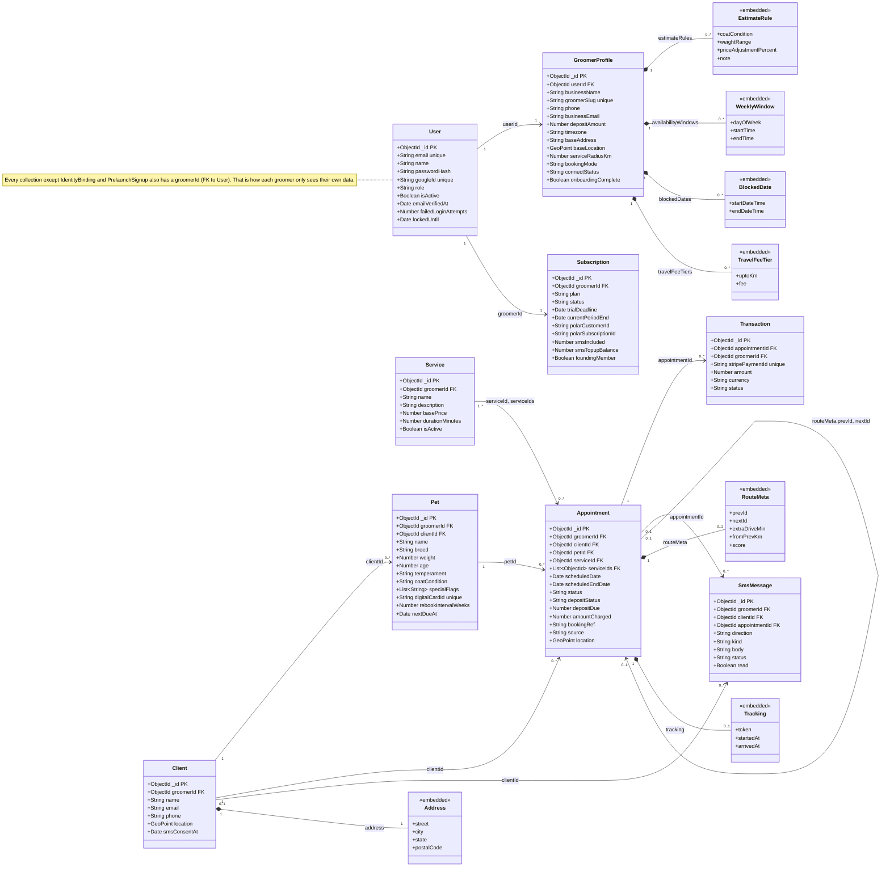
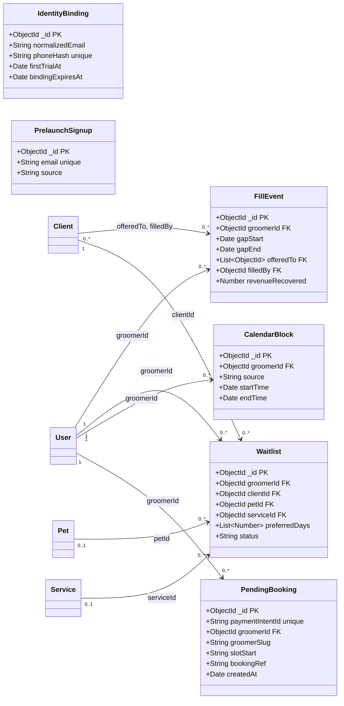

# Pawxis Database Schema

**Database:** MongoDB Atlas, accessed through Mongoose. **Short-lived data:** Upstash Redis (section 5).
**Collections:** 17 defined, 15 in use (1 legacy, 1 unused; see section 6).
**Source of truth:** `src/lib/db/models/*`. Generated on 2026-11-17 from commit `e7a1862`.
Regenerate after any schema change with `npx tsx scripts/gen-schema-doc.ts`. The script only reads the schema definitions and never connects to a database.

---

## 1. How the data is organised

- **`User` is the hub.** A User is a groomer's account. Almost every other collection carries a `groomerId` that points back to it, so each groomer only ever sees their own data (multi-tenant by `groomerId`).
- **Clients are not users.** A `Client` is a groomer's customer record. There is no client login or client table of accounts; clients reach the product through links (booking page, tracker, pet card).
- **Documents, not tables.** Related data that always travels together is **embedded** inside its parent document (for example a client's `address`, or a profile's `estimateRules`). Everything else is linked by `ObjectId`.
- **No database-enforced foreign keys.** MongoDB does not enforce references. The application keeps them consistent.
- **Money** is stored as plain numbers in **dollars** (not cents), for example `basePrice: 95`.
- **Dates** are stored as UTC instants. The groomer's IANA timezone (`GroomerProfile.timezone`) is used to display them and to build slots.
- **Timestamps:** every collection except `PendingBooking` and `Reservation` has `createdAt` and `updatedAt`. Every document has an `_id` (ObjectId).
- **Secrets:** a groomer's own Stripe key is stored encrypted (`ownStripeKeyEnc`) and is excluded from normal queries. Phone numbers used for the trial check are stored only as a one-way hash.

---

## 2. Diagrams (UML class diagrams)

Two diagrams, so each stays readable. They show keys and the main fields, not every field (full field tables are in section 4). **PK** is the primary key and **FK** a link to another collection. An arrow is a link by id with its cardinality. A filled diamond is a document embedded inside its parent. `GeoPoint` is an embedded latitude/longitude pair (`{ lat, lng }`), shown as a field type.

### 2a. Core data model

Mermaid source (also saved as `docs/images/database-schema-core.mmd`; paste into mermaid.live or another UML tool)

### 2b. Automation and support collections

These sit around the core model: Fill My Day (`FillEvent`, `Waitlist`), time blocks, in-flight payments, and the anti-abuse and pre-launch tables. Boxes with only a name are the core collections, repeated for context.

Mermaid source (also saved as `docs/images/database-schema-support.mmd`; paste into mermaid.live or another UML tool)

---

## 3. Relationships

| From | Field | To | Meaning |
|---|---|---|---|
| `GroomerProfile` | `userId` | `User` | One profile per user (unique) |
| `Subscription` | `groomerId` | `User` | One subscription per user (unique) |
| `Service`, `Client`, `Pet`, `Appointment`, `Transaction`, `SmsMessage`, `FillEvent`, `Waitlist`, `CalendarBlock`, `PendingBooking` | `groomerId` | `User` | Owned by one groomer (many per groomer) |
| `Pet` | `clientId` | `Client` | A client has many pets |
| `Appointment` | `clientId`, `petId` | `Client`, `Pet` | Who and which pet |
| `Appointment` | `serviceId`, `serviceIds[]` | `Service` | The main service, and the full list when several are booked |
| `Appointment` | `routeMeta.prevId`, `routeMeta.nextId` | `Appointment` | The stops before and after on the same day (route chain) |
| `Transaction` | `appointmentId` | `Appointment` | A card deposit for a booking |
| `SmsMessage` | `clientId`, `appointmentId` | `Client`, `Appointment` | Both optional: a message can come from an unknown number (no client) and need not relate to a booking |
| `FillEvent` | `offeredTo[]`, `filledBy` | `Client` | Who was offered a freed slot, and who took it |
| `Waitlist` | `clientId` (required), `petId`, `serviceId` | `Client`, `Pet`, `Service` | A client waiting for a slot |

`IdentityBinding` and `PrelaunchSignup` are standalone: they link to nothing.

---

## 4. Collections and fields

Each table lists every field in the schema. `_id`, `createdAt` and `updatedAt` are omitted (see section 1). Sub-document fields are shown as `parent.child`.

### Appointment

**Collection:** `appointments`. A booking: who, which pet, which service(s), when, status, deposit, final amount charged, route data and live-tracking state.

| Field | Type | Flags | Notes |
|---|---|---|---|
| `groomerId` | ObjectId | required | ref **User** |
| `clientId` | ObjectId | required | ref **Client** |
| `petId` | ObjectId | required | ref **Pet** |
| `serviceId` | ObjectId | required | ref **Service** |
| `serviceIds` | ObjectId[] | - | ref **Service** |
| `scheduledDate` | Date | required | - |
| `scheduledEndDate` | Date | required | - |
| `status` | String | - | one of `upcoming`, `in-progress`, `completed`, `cancelled`; default `"upcoming"` |
| `serviceAddress` | String | - | max 500 chars |
| `depositStatus` | String | - | one of `pending`, `received` |
| `depositDue` | Number | - | range 0–500 |
| `amountCharged` | Number | - | range 0–99999 |
| `notes` | String | - | max 500 chars |
| `postGroomNotes` | String | - | max 2000 chars |
| `bookingRef` | String | - | max 32 chars |
| `location` | Subdocument | - | - |
| ↳ `location.lat` | Number | required | range -90–90 |
| ↳ `location.lng` | Number | required | range -180–180 |
| `routeMeta` | Subdocument | - | - |
| ↳ `routeMeta.prevId` | ObjectId | - | ref **Appointment**; default `null` |
| ↳ `routeMeta.nextId` | ObjectId | - | ref **Appointment**; default `null` |
| ↳ `routeMeta.extraDriveMin` | Number | - | - |
| ↳ `routeMeta.fromPrevKm` | Number | - | - |
| ↳ `routeMeta.score` | Number | - | - |
| `flexible` | Boolean | - | default `false` |
| `source` | String | - | one of `public`, `manual`, `claim`, `rebook`; default `"public"` |
| `reminderJobIds` | String[] | - | - |
| `reminder24SentAt` | Date | - | - |
| `reminder2SentAt` | Date | - | - |
| `tracking` | Subdocument | - | - |
| ↳ `tracking.token` | String | - | - |
| ↳ `tracking.startedAt` | Date | - | - |
| ↳ `tracking.arrivedAt` | Date | - | - |
| `beforePhotoUrl` | String | - | - |
| `afterPhotoUrl` | String | - | - |

**Indexes**

| Keys | Properties |
|---|---|
| status ↑, scheduledDate ↑ | - |
| groomerId ↑, scheduledDate ↑ | - |
| groomerId ↑, status ↑ | - |
| clientId ↑ | - |
| petId ↑ | - |
| groomerId ↑, scheduledDate ↑ | - |

### Availability

**Collection:** `availabilities`. **Unused.** A planned replacement for weekly hours and blocks. Nothing reads or writes it; weekly hours and blocked dates live on `GroomerProfile`.

| Field | Type | Flags | Notes |
|---|---|---|---|
| `groomerId` | ObjectId | required, unique | ref **User** |
| `weeklyWindows` | Subdocument[] | - | - |
| ↳ `weeklyWindows.day` | Number | required | range 0–6 |
| ↳ `weeklyWindows.start` | String | required | - |
| ↳ `weeklyWindows.end` | String | required | - |
| `blocks` | Subdocument[] | - | - |
| ↳ `blocks.startAt` | Date | required | - |
| ↳ `blocks.endAt` | Date | required | - |
| ↳ `blocks.reason` | String | - | max 200 chars |
| `timezone` | String | - | default `"UTC"` |

**Indexes**

| Keys | Properties |
|---|---|
| groomerId ↑ | unique |

### CalendarBlock

**Collection:** `calendarblocks`. A block of unavailable time on a groomer's calendar (a break, a busy period, or time from a shared calendar). Read when computing open slots; nothing in the app writes it yet.

| Field | Type | Flags | Notes |
|---|---|---|---|
| `groomerId` | ObjectId | - | ref **User** |
| `source` | String | - | one of `groomer`, `shared-calendar`; default `"groomer"` |
| `startTime` | Date | required | - |
| `endTime` | Date | required | - |

**Indexes**

| Keys | Properties |
|---|---|
| groomerId ↑, startTime ↑, endTime ↑ | - |
| source ↑, startTime ↑, endTime ↑ | - |

### Client

**Collection:** `clients`. One of a groomer's customers (the pet owner). Scoped to a groomer; the same person booking with two groomers is two Client rows.

| Field | Type | Flags | Notes |
|---|---|---|---|
| `groomerId` | ObjectId | required | ref **User** |
| `name` | String | required | max 100 chars |
| `email` | String | required | max 254 chars |
| `phone` | String | required | max 15 chars |
| `address` | Subdocument | required | - |
| ↳ `address.street` | String | required | max 200 chars |
| ↳ `address.city` | String | required | max 100 chars |
| ↳ `address.state` | String | required | max 100 chars |
| ↳ `address.postalCode` | String | required | max 20 chars |
| `location` | Subdocument | - | - |
| ↳ `location.lat` | Number | required | range -90–90 |
| ↳ `location.lng` | Number | required | range -180–180 |
| `smsConsentAt` | Date | - | - |
| `smsOptOut` | Boolean | - | - |

**Indexes**

| Keys | Properties |
|---|---|
| groomerId ↑, email ↑ | unique |
| groomerId ↑, name ↑, email ↑, phone ↑ | - |

### FillEvent

**Collection:** `fillevents`. One Fill My Day attempt: the gap that opened, who was offered it, who took it, and the revenue recovered. Drives the "recovered this month" number.

| Field | Type | Flags | Notes |
|---|---|---|---|
| `groomerId` | ObjectId | required | ref **User** |
| `gapStart` | Date | required | - |
| `gapEnd` | Date | required | - |
| `offeredTo` | ObjectId[] | - | ref **Client** |
| `filledBy` | ObjectId | - | ref **Client** |
| `revenueRecovered` | Number | - | range 0– |

**Indexes**

| Keys | Properties |
|---|---|
| groomerId ↑, createdAt ↓ | - |

### GroomerProfile

**Collection:** `groomerprofiles`. The groomer's business settings, one per user: public booking link, deposit, price rules, working hours, service area, routing settings, own-Stripe settings and onboarding progress.

| Field | Type | Flags | Notes |
|---|---|---|---|
| `userId` | ObjectId | required, unique | ref **User** |
| `businessName` | String | - | max 100 chars |
| `groomerSlug` | String | unique | - |
| `logoUrl` | String | - | - |
| `phone` | String | - | max 15 chars |
| `businessEmail` | String | - | max 254 chars |
| `depositAmount` | Number | - | default `0`; range 0–500 |
| `depositPaymentLink` | String | - | max 500 chars |
| `ownStripeKeyEnc` | String | - | hidden from normal queries (secret) |
| `ownStripeWebhookSecretEnc` | String | - | hidden from normal queries (secret) |
| `ownStripeWebhookId` | String | - | - |
| `ownStripeKeyHint` | String | - | max 40 chars |
| `ownStripeAccountName` | String | - | max 200 chars |
| `ownStripeLivemode` | Boolean | - | - |
| `ownStripeConnectedAt` | Date | - | - |
| `estimateRules` | Subdocument[] | - | - |
| ↳ `estimateRules.coatCondition` | String | - | one of `smooth`, `double`, `wire`, `curly`, `long`, `matted` |
| ↳ `estimateRules.weightRange.min` | Number | - | - |
| ↳ `estimateRules.weightRange.max` | Number | - | - |
| ↳ `estimateRules.priceAdjustmentPercent` | Number | - | range -50–50 |
| ↳ `estimateRules.note` | String | - | max 500 chars |
| `availabilityWindows` | Subdocument[] | - | - |
| ↳ `availabilityWindows.dayOfWeek` | Number | - | range 0–6 |
| ↳ `availabilityWindows.startTime` | String | - | - |
| ↳ `availabilityWindows.endTime` | String | - | - |
| `blockedDates` | Subdocument[] | - | - |
| ↳ `blockedDates.startDateTime` | Date | required | - |
| ↳ `blockedDates.endDateTime` | Date | required | - |
| `onboardingComplete` | Boolean | - | default `false` |
| `onboardingStep` | Number | - | default `0` |
| `themePreference` | String | - | one of `light`, `dark`; default `"light"` |
| `serviceIntervalDays` | Number | - | default `42` |
| `timezone` | String | - | default `"UTC"` |
| `baseAddress` | String | - | max 300 chars |
| `baseLocation` | Subdocument | - | - |
| ↳ `baseLocation.lat` | Number | required | range -90–90 |
| ↳ `baseLocation.lng` | Number | required | range -180–180 |
| `serviceRadiusKm` | Number | - | range 0– |
| `serviceAreaPolygon` | Mixed | - | - |
| `maxDetourMin` | Number | - | default `25`; range 0– |
| `bufferMin` | Number | - | default `10`; range 0– |
| `slotStepMin` | Number | - | default `15`; range 5– |
| `minNoticeHours` | Number | - | default `12`; range 0– |
| `maxAdvanceDays` | Number | - | default `30`; range 1– |
| `avgSpeedKmh` | Number | - | default `32`; range 1– |
| `roadFactor` | Number | - | default `1.35`; range 1– |
| `parkingMin` | Number | - | default `3`; range 0– |
| `travelFeeTiers` | Subdocument[] | - | - |
| ↳ `travelFeeTiers.uptoKm` | Number | required | range 0– |
| ↳ `travelFeeTiers.fee` | Number | required | range 0– |
| `bookingMode` | String | - | one of `instant`, `request`; default `"instant"` |
| `icsFeedToken` | String | - | - |
| `depositPolicy` | String | - | max 1000 chars |
| `stripeConnectAccountId` | String | - | - |
| `stripeConnectChargesEnabled` | Boolean | - | default `false` |
| `connectStatus` | String | - | one of `not_started`, `pending`, `needs_info`, `complete`, `disabled`; default `"not_started"` |

**Indexes**

| Keys | Properties |
|---|---|
| userId ↑ | unique |
| groomerSlug ↑ | unique, sparse |

### IdentityBinding

**Collection:** `identitybindings`. Anti-abuse record for the free trial: one trial per phone number. Stores only a one-way hash of the phone, never the number itself.

| Field | Type | Flags | Notes |
|---|---|---|---|
| `normalizedEmail` | String | required | - |
| `phoneHash` | String | required, unique | - |
| `firstTrialAt` | Date | required | - |
| `bindingExpiresAt` | Date | - | default `null` |
| `deviceFingerprints` | String[] | - | default `[]` |
| `ips` | String[] | - | default `[]` |

**Indexes**

| Keys | Properties |
|---|---|
| normalizedEmail ↑ | - |
| phoneHash ↑ | unique |

### PendingBooking

**Collection:** `pendingbookings`. Holds the pet, owner and slot while a deposit payment is in progress, because the payment provider's metadata is too small. Consumed when the payment succeeds. **Deleted automatically after 1 hour.**

| Field | Type | Flags | Notes |
|---|---|---|---|
| `paymentIntentId` | String | required, unique | - |
| `groomerId` | ObjectId | required | ref **User** |
| `groomerSlug` | String | required | - |
| `pet` | Mixed | required | - |
| `owner` | Mixed | required | - |
| `slotStart` | String | required | - |
| `slotEnd` | String | - | - |
| `serviceId` | String | - | - |
| `holdId` | String | - | - |
| `smsConsent` | Boolean | - | - |
| `bookingRef` | String | - | max 32 chars |

**Indexes**

| Keys | Properties |
|---|---|
| paymentIntentId ↑ | unique |
| createdAt ↑ | auto-delete after 1 h |

### Pet

**Collection:** `pets`. A pet belonging to a client. Holds the grooming profile (breed, coat, temperament) and the rebooking cycle (`rebookIntervalWeeks`, `nextDueAt`).

| Field | Type | Flags | Notes |
|---|---|---|---|
| `clientId` | ObjectId | required | ref **Client** |
| `groomerId` | ObjectId | required | ref **User** |
| `name` | String | required | max 50 chars |
| `photoUrl` | String | - | - |
| `breed` | String | required | - |
| `weight` | Number | required | range 1–200 |
| `weightUnit` | String | - | one of `lbs`, `kg`; default `"lbs"` |
| `age` | Number | required | range 0–30 |
| `temperament` | String | required | one of `calm`, `nervous`, `aggressive`, `friendly` |
| `coatCondition` | String | required | one of `smooth`, `double`, `wire`, `curly`, `long`, `matted` |
| `specialFlags` | String[] | - | - |
| `notes` | String | - | max 500 chars |
| `digitalCardId` | String | unique | - |
| `rebookIntervalWeeks` | Number | - | range 1–52 |
| `lastGroomAt` | Date | - | - |
| `nextDueAt` | Date | - | - |
| `lastNudgedAt` | Date | - | - |

**Indexes**

| Keys | Properties |
|---|---|
| digitalCardId ↑ | unique, sparse |
| clientId ↑ | - |
| groomerId ↑ | - |
| groomerId ↑, nextDueAt ↑ | - |

### PrelaunchSignup

**Collection:** `prelaunchsignups`. Emails collected on the coming-soon page before launch. Not connected to any other collection.

| Field | Type | Flags | Notes |
|---|---|---|---|
| `email` | String | required, unique | max 254 chars |
| `source` | String | - | default `"coming-soon"`; max 60 chars |

**Indexes**

| Keys | Properties |
|---|---|
| email ↑ | unique |

### Reservation

**Collection:** `reservations`. **Legacy.** An old short-lived slot hold, replaced by Redis holds. Only kept so an old test still runs. Not used by the app.

| Field | Type | Flags | Notes |
|---|---|---|---|
| `groomerId` | ObjectId | required | ref **User** |
| `slotStart` | Date | required | - |
| `slotEnd` | Date | required | - |
| `sessionId` | String | required | - |
| `expiresAt` | Date | required | - |

**Indexes**

| Keys | Properties |
|---|---|
| expiresAt ↑ | auto-delete after its own date passes |
| groomerId ↑, slotStart ↑, slotEnd ↑ | - |

### Service

**Collection:** `services`. A service a groomer offers (name, price, duration). Hidden from booking with `isActive: false`.

| Field | Type | Flags | Notes |
|---|---|---|---|
| `groomerId` | ObjectId | required | ref **User** |
| `name` | String | required | max 100 chars |
| `description` | String | - | max 500 chars |
| `basePrice` | Number | required | range 0.01–9999.99 |
| `durationMinutes` | Number | required | range 15–480 |
| `isActive` | Boolean | - | default `true` |

**Indexes**

| Keys | Properties |
|---|---|
| groomerId ↑, isActive ↑ | - |

### SmsMessage

**Collection:** `smsmessages`. The client message log that powers the Inbox: every outgoing and incoming message, with its kind (confirmation, reminder, reply...) and delivery status.

| Field | Type | Flags | Notes |
|---|---|---|---|
| `groomerId` | ObjectId | required | ref **User** |
| `clientId` | ObjectId | - | ref **Client**; default `null` |
| `appointmentId` | ObjectId | - | ref **Appointment**; default `null` |
| `direction` | String | required | one of `in`, `out` |
| `kind` | String | required | one of `booking_confirmed`, `reminder_24h`, `reminder_2h`, `on_my_way`, `running_late`, `rescheduled`, `cancelled`, `fill_my_day_offer`, `rebook_nudge`, `review_request`, `deposit_receipt`, `reply` |
| `body` | String | required | max 2000 chars |
| `twilioSid` | String | - | - |
| `status` | String | required | default `"queued"`; max 40 chars |
| `errorCode` | String | - | max 40 chars |
| `segments` | Number | - | range 0– |
| `phone` | String | - | max 20 chars |
| `read` | Boolean | - | default `false` |

**Indexes**

| Keys | Properties |
|---|---|
| twilioSid ↑ | sparse |
| groomerId ↑, clientId ↑, createdAt ↓ | - |
| groomerId ↑, phone ↑, createdAt ↓ | - |

### Subscription

**Collection:** `subscriptions`. The groomer's plan and billing state, one per user: trial dates, Polar customer and subscription ids, plan, status and message allowance.

| Field | Type | Flags | Notes |
|---|---|---|---|
| `groomerId` | ObjectId | required, unique | ref **User** |
| `plan` | String | required | one of `trial`, `solo`, `pro`; default `"trial"` |
| `status` | String | required | one of `trialing`, `active`, `past_due`, `canceled`, `expired`; default `"trialing"` |
| `trialEndsAt` | Date | - | default `null` |
| `trialStartedAt` | Date | - | default `null` |
| `trialDeadline` | Date | - | default `null` |
| `pastDueSince` | Date | - | default `null` |
| `currentPeriodEnd` | Date | - | default `null` |
| `stripeCustomerId` | String | - | default `null` |
| `stripeSubscriptionId` | String | - | default `null` |
| `polarCustomerId` | String | - | default `null` |
| `polarSubscriptionId` | String | - | default `null` |
| `polarSyncedAt` | Date | - | default `null` |
| `polarTopupOrderIds` | String[] | - | default `[]` |
| `smsIncluded` | Number | - | default `300`; range 0– |
| `smsTopupBalance` | Number | - | default `0`; range 0– |
| `foundingMember` | Boolean | - | default `false` |

**Indexes**

| Keys | Properties |
|---|---|
| groomerId ↑ | unique |
| stripeCustomerId ↑ | sparse |
| stripeSubscriptionId ↑ | sparse |
| polarCustomerId ↑ | sparse |
| polarSubscriptionId ↑ | sparse |

### Transaction

**Collection:** `transactions`. A succeeded or attempted **card deposit** payment for an appointment (Stripe). Payment-link deposits are tracked on the appointment (`depositStatus`) instead.

| Field | Type | Flags | Notes |
|---|---|---|---|
| `appointmentId` | ObjectId | required | ref **Appointment** |
| `groomerId` | ObjectId | required | ref **User** |
| `stripePaymentId` | String | required, unique | - |
| `amount` | Number | required | range 0– |
| `currency` | String | - | default `"usd"`; max 3 chars |
| `status` | String | - | one of `pending`, `succeeded`, `failed`, `refunded`; default `"pending"` |

**Indexes**

| Keys | Properties |
|---|---|
| stripePaymentId ↑ | unique |
| appointmentId ↑ | - |
| groomerId ↑, createdAt ↓ | - |

### User

**Collection:** `users`. A groomer's login account (email and password, or Google). The hub of the data model: nearly every other collection points back to it. Clients are **not** users; they have no login.

| Field | Type | Flags | Notes |
|---|---|---|---|
| `email` | String | required, unique | max 254 chars |
| `passwordHash` | String | - | default `null` |
| `name` | String | required | max 100 chars |
| `googleId` | String | unique | - |
| `role` | String | - | one of `groomer`; default `"groomer"` |
| `isActive` | Boolean | - | default `false` |
| `failedLoginAttempts` | Number | - | default `0` |
| `lockedUntil` | Date | - | default `null` |
| `emailVerifiedAt` | Date | - | default `null` |

**Indexes**

| Keys | Properties |
|---|---|
| email ↑ | unique |
| googleId ↑ | unique, sparse |

### Waitlist

**Collection:** `waitlists`. A client waiting for a slot (preferred days and date range). Fill My Day offers freed slots to these entries first.

| Field | Type | Flags | Notes |
|---|---|---|---|
| `groomerId` | ObjectId | required | ref **User** |
| `clientId` | ObjectId | required | ref **Client** |
| `petId` | ObjectId | - | ref **Pet** |
| `serviceId` | ObjectId | - | ref **Service** |
| `preferredDays` | Number[] | - | default `[]` |
| `earliestDate` | Date | - | - |
| `latestDate` | Date | - | - |
| `status` | String | - | one of `active`, `offered`, `filled`, `expired`; default `"active"` |

**Indexes**

| Keys | Properties |
|---|---|
| groomerId ↑, status ↑ | - |
| clientId ↑ | - |

---

## 5. Short-lived data (Redis)

These are not stored in MongoDB. They are temporary keys that expire on their own. If Redis is unavailable, booking holds, live tracking and password reset stop working and the rest degrades gracefully.

| Key | Lives for | Purpose | What it holds |
|---|---|---|---|
| `hold:{groomerId}:{holdId}` | 10 min | Slot hold | A time reserved while a client finishes booking |
| `holds:{groomerId}:{date}` | 1 day | Slot hold index | The holds on a day, for fast availability checks |
| `lock:book:{groomerId}` | 10 s | Booking lock | Stops two bookings for the same slot at the same instant |
| `avail:{groomerId}:{date}` | 60 s | Cache | Computed open slots for a day |
| `ent:{groomerId}` | 60 s | Cache | The groomer's plan and feature access |
| `geo:{addressHash}` | 30 days | Cache | Geocoded address |
| `tt:{hashA}:{hashB}` | 7 days | Cache | Drive time between two places |
| `track:{token}` | 2 h | Live tracking | The van's current position for the client's tracker link |
| `claim:{token}` | 30 min | Fill My Day | A slot offer a client can claim |
| `claimwon:{groomerId}:{startMs}` | 30 min | Fill My Day | Marks a slot as taken, so only the first claimer wins |
| `rebook:{token}` | 30 days | Rebooking | A client's rebook link |
| `cron:rebook:{date}` | 25 h | Rebooking | Marks that the daily rebook sweep already ran |
| `idem:stripe:{eventId}` | 7 days | Idempotency | Prevents handling the same Stripe event twice |
| `email:day:{date}` and `:alert` | 48 h | Email cap | Emails sent today, and whether the founder alert went out |
| `evf:{token}` | 30 min | Email verification | One-time verification link |
| `evf:rl:{email}` | 60 s | Email verification | Resend cooldown |
| `pwr:{sha256(token)}` | 1 h | Password reset | One-time reset link, stored as a hash |
| `pwr:rl:{email}` | 60 s | Password reset | Reset-email cooldown |
| `otp:{phoneHash}` and `otp:rl:{phoneHash}` | 10 min / 60 s | Phone check | One-time code and its resend limit |
| `vel:dev:{fingerprint}` and `vel:ip:{maskedIp}` | 24 h | Trial abuse | Counts of trials started per device and per IP |

---

## 6. Things worth knowing

1. **`Availability` is not used.** The model is defined but nothing reads or writes it. A groomer's weekly hours and blocked dates are stored on `GroomerProfile` (`availabilityWindows`, `blockedDates`). It can be deleted.
2. **`Reservation` is legacy.** Booking holds now live in Redis. The model remains only for an old test.
3. **`CalendarBlock` is read but never written by the app.** Slot calculation reads it (for blocks from a shared calendar), but nothing creates rows yet, so it is empty in practice. Groomers add time off through `GroomerProfile.blockedDates` on the Availability page.
4. **Two service links on `Appointment`.** `serviceId` is the original, required field and `serviceIds` the newer multi-service list. Code that needs all services should read `serviceIds` and fall back to `serviceId`.
5. **`PendingBooking.pet` and `.owner` are free-form (`Mixed`).** They are a snapshot of the booking form while payment is in progress, and the whole row deletes itself after 1 hour.
6. **Revenue has no separate table.** It is computed from `Appointment.amountCharged` for completed jobs and from `Transaction` and `depositDue` for deposits (see the product guide, section 10).
7. **Card deposits vs payment links.** Card deposits create a `Transaction`. Payment-link deposits do not; they set `Appointment.depositStatus` when the groomer marks them received.
8. **Plan limits are not stored per feature.** `Subscription.plan` decides access in code (`src/lib/plans.ts`).
9. **Schema, not live data.** This document describes what the code defines. It does not inspect the production database, so indexes shown here are the ones the code asks for.
